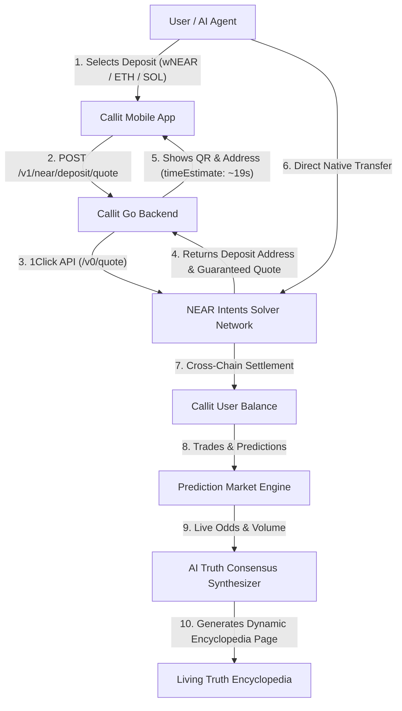

# Callit — NEAR Hackathon: Build Beyond Boundaries

> **Track Submissions:** `defi` (Unstoppable DeFi) & `agents` (Agent Economy)  
> **Built During:** November 1 – November 14, 2026  
> **Team:** Eric Alfred (`@heyricky__`), Gideon Jones (`@gideonjones_`)  
> **Live API Base:** `https://ads-headset-kilometers-finite.trycloudflare.com/v1`  
> **Mobile Client Repo:** `git@github.com:shipporlabs/callitApp.git`  
> **Backend Repo:** `git@github.com:Ealfred1/callit-backend.git`

---

## 1. Executive Summary & Vision

Callit is a mobile-first social prediction market platform where any take or headline is compiled by AI into an on-chain market.

For the **NEAR Protocol Hackathon**, we implemented two foundational pillars:
1. **1-Click Multi-Chain Funding via NEAR Intents (Defuse Protocol):**  
   Users and AI agents on **NEAR, Base, Ethereum, and Solana** can fund their Callit balances in ~19 seconds without manual bridging, wrapped tokens, or multi-step DEX hops. Solvers non-custodially settle deposits directly into user accounts.
2. **AI Truth Encyclopedia (Illia Polosukhin's Benchmark Concept):**  
   Fulfills NEAR co-founder Illia Polosukhin's official hackathon wishlist:
   > *"AI encyclopedia with prediction markets: instead of community curation, every fact becomes a perpetual truth-seeking market (Augur style). The final pages are generated by AI based on current market understanding."*  
   Every Callit market automatically synthesizes a dynamic, cited fact sheet derived from real capital allocation, market odds, and verified sources of truth.

---

## 2. Rule Q-002 & Q-003 Compliance Disclosure

Per Hackathon Rules:
* **Pre-Existing Codebase (Before Nov 1, 2026):**  
  Solana-based prediction market core engine, FossaPay NGN fiat rail, mobile UI layout.
* **Built Exclusively Within Hackathon Window (Nov 1 – Nov 14, 2026):**
  - **NEAR Intents / 1Click Client & Adapter:** Full integration with 1Click API (`https://1click.chaindefuser.com/v0`), multi-chain quote calculation, single-use solver deposit address generation, and real-time execution status polling.
  - **NEAR Intents Service & API Handlers:** Endpoints `/v1/near/tokens`, `/v1/near/deposit/quote`, `/v1/near/deposit/status`.
  - **AI Truth Consensus Engine:** Service & handler `/v1/markets/:id/truth-consensus` transforming prediction probabilities into dynamic encyclopedia articles.
  - **Mobile UI 1-Click Deposit & Truth Explorer:** Dedicated NEAR Intents deposit screen (`near_intents_deposit_screen.dart`), multi-chain deposit selector, and in-app Truth Consensus sheet.

---

## 3. Architecture Overview



---

## 4. Verification & Testing ("Do X, See Y")

For AI Screening (Claude Code / Codex) and Human Reviewers, verify the live endpoints below:

### Step 1: Health & Supported NEAR Intents Tokens
```bash
# Do:
curl -s "https://ads-headset-kilometers-finite.trycloudflare.com/v1/near/tokens" | jq .

# See:
# Returns list of supported cross-chain assets (wNEAR, SOL, ETH, USDC) with prices and decimals.
```

### Step 2: Calculate a Guaranteed Cross-Chain Quote
```bash
# Do:
curl -s -X POST "https://ads-headset-kilometers-finite.trycloudflare.com/v1/near/deposit/quote" \
  -H "Content-Type: application/json" \
  -H "Authorization: Bearer <AUTH_TOKEN>" \
  -d '{
    "originAsset": "wNEAR",
    "destinationAsset": "SOL",
    "amountFormatted": "1.0",
    "dry": true
  }' | jq .

# See:
# Returns output amount (amountOutFormatted), USD values, timeEstimateSec (~19s), and solver protocol details.
```

### Step 3: Inspect the AI Truth Consensus (Illia's Encyclopedia Entry)
```bash
# Do:
curl -s "https://ads-headset-kilometers-finite.trycloudflare.com/v1/markets/7y45RD53QHg7tfcbeZQt76NRPkhXK6CVN3e3K9d9oCS6/truth-consensus" | jq .

# See:
# Returns structured truth assessment:
# - consensusVerdict: "HIGHLY CONTESTED / SPLIT OPINION (49.8% YES / 50.2% NO)"
# - confidenceLevel: "SPECULATIVE"
# - encyclopediaEntry: Complete markdown article synthesized from odds and verified sources.
```

### Step 4: Run Automated Backend Tests
```bash
cd callit-backend
go test -v ./internal/service/...
# All tests pass:
# - TestNearIntentsService_ListTokensAndQuote
# - TestTruthSynthesisService_Synthesize
```
